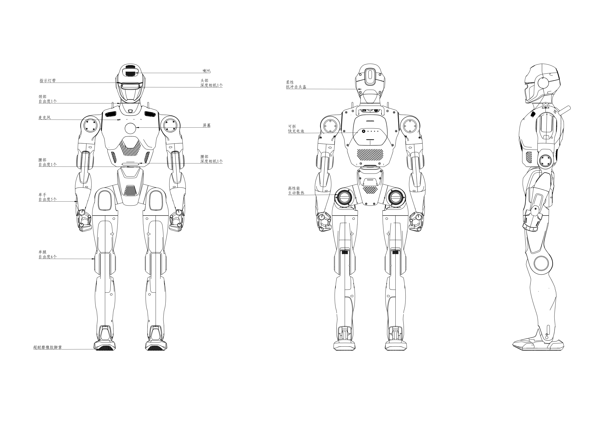

<!-- 来源: https://engineai.com.cn/open/docs/pm01/pm01/01?product=pm01 -->

# 1. 产品概述

众擎PM01是一款**全开放的通用具身智能体**，专为科研、教育及工业应用开发设计。

### 1.部件名称与自由度

通过**145N·m关节扭矩**及**5%力控精度**的高性能关节电机，机器人能够实现精确的运动和姿态控制。

 | 类型 | PM01-教育版
 | 总自由度 | 24
 | 单腿自由度 | 6
 | 腰部自由度 | 1
 | 颈部自由度 | 1
 | 单手臂自由度 | 5

**部件说明图：**

### 2 机器人规格

 | 型号 | PM01-教育版
 | 产品尺寸 | 1400(H)×535.55(W)×252.66(D)
 | 带电重量 | 约43kg
 | 小腿+大腿长度 | 686.5mm
 | 手臂伸展 | 1.44m
 | 总自由度 | 24
 | 颈部自由度 | 1
 | 单臂自由度 | 6
 | 腰部自由度 | 1
 | 单手臂自由度 | 5
 | 关节运动空间 | 腰关节：-230°~90°
髋关节：R（横滚角）-29°~+134°、P（俯仰角）-180°~+140°、Y（偏航角）-90°~+230°
膝关节：-30°~+137°
 | 运动速度 | >2m/s(硬件支持)
 | 感知传感器 | 深度相机2个（头部和腰部）
 | 基础算力 | 4核高性能CPU
 | 高算力模组 | NVIDIA Jetson Orin NX 16GB
 | 二次开发 | 支持
 | 智能电池（快充） | 10000mAh
 | 续航时间 | 约2小时
 | 充电功率 | 54.6V4.5A
 | 充电速度 | 约2h充满
 | 灯光配置 | 眼部灯、臀部灯
