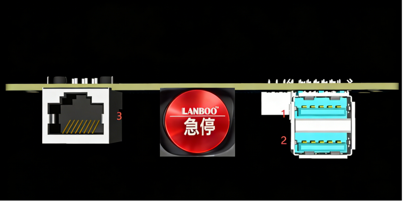

<!-- 来源: https://engineai.com.cn/open/docs/pm01/pm01/04?product=pm01 -->

# 4 关节系统

### 1 关节电机

**Q系列高性能伺服电机**

PM01关节采用众擎自研的Q系列高性能伺服电机：

- **Q90H主关节电机**：最大扭矩145N·m，用于髋、膝等主要关节
- **Q25H轻量关节电机**：最大扭矩50N·m，用于踝、肩、肘等关节

核心优势：中空轴线设计、双编码器系统、低惯量转子、优化散热

电机配备**双编码器系统**，集成高精度位置编码器和力矩/电流传感器，提供更准确的位置和速度反馈，满足高精度控制需求。低惯量转子设计确保快速响应和优异的动态性能，优化的散热设计支持电机长时间高负载运行。

 | 电机型号 | Q90H | Q25H
 | 关节编码器 | 双编码 | 双编码
 | 关节类型 | 全行星 | 全行星
 | 最大力矩(Nm) | 145 | 50
 | 峰值扭矩密度 | 130Nm/kg | 100 Nm/kg
 | 最高转速(rpm) | 6400 | 8400
 | 减速比 | 25 | 25
 | 质量(kg) | 1.1 | 0.5
 | 直径(mm) | 86 | 62
 | 高度(mm) | 62 | 60
 | 额定电压(V) | 48 | 48
 | 力控精度 | 5% | 5%

### 2 关节序号与限位

**关节命名规则**

• 关节命名格式：J[序号]_[部位]_[动作]_[左右]

• 连杆命名格式：LINK_[部位]_[动作]_[左右]

• 角度单位：弧度(rad)

**注意**：开发时请严格遵守关节限位，超出限位范围可能导致硬件损坏

 | **序号** | **连杆** | **连杆、meshes命名** | **关节命名** | **关节型号** | **关节端角度下限**
**(rad)** | **关节端角度上限**
**(rad)**
 | 1 | 左髋俯仰 | LINK_HIP_PITCH_L | J00_HIP_PITCH_L | Q90H | -3.141 | 2.443
 | 2 | 左髋横滚 | LINK_HIP_ROLL_L | J01_HIP_ROLL_L | Q90H | -0.436 | 2.094
 | 3 | 左髋偏航 | LINK_HIP_YAW_L | J02_HIP_YAW_L | Q25H-L | -1.57 | 4.014
 | 4 | 左膝俯仰 | LINK_KNEE_PITCH_L | J03_KNEE_PITCH_L | Q90H | -0.2618 | 2.3562
 | 5 | 左踝俯仰 | LINK_ANKLE_PITCH_L | J04_ANKLE_PITCH_L | Q25H | -0.6807 | 0.7243
 | 6 | 左踝横滚 | LINK_ANKLE_ROLL_L | J05_ANKLE_ROLL_L | Q25H | -0.2618 | 0.2618
 | 7 | 右髋俯仰 | LINK_HIP_PITCH_R | J06_HIP_PITCH_R | Q90H | -3.141 | 2.443
 | 8 | 右髋横滚 | LINK_HIP_ROLL_R | J07_HIP_ROLL_R | Q90H | -2.094 | 0.436
 | 9 | 右髋偏航 | LINK_HIP_YAW_R | J08_HIP_YAW_R | Q25H-L | -4.014 | 1.57
 | 10 | 右膝俯仰 | LINK_KNEE_PITCH_R | J09_KNEE_PITCH_R | Q90H | -0.2618 | 2.3562
 | 11 | 右踝俯仰 | LINK_ANKLE_PITCH_R | J10_ANKLE_PITCH_R | Q25H | -0.6807 | 0.7243
 | 12 | 右踝横滚 | LINK_ANKLE_ROLL_R | J11_ANKLE_ROLL_R | Q25H | -0.2618 | 0.2618
 | 35 | 腰偏航 | LINK_TORSO_YAW | J12_WAIST_YAW | Q25H-L | -4.014 | 1.57
 | 23 | 左肩俯仰 | LINK_SHOULDER_PITCH_L | J13_SHOULDER_PITCH_L | Q25H | -2.9671 | 2.7925
 | 24 | 左肩横滚 | LINK_SHOULDER_ROLL_L | J14_SHOULDER_ROLL_L | Q25H | -0.6108 | 2.3562
 | 25 | 左肩偏航 | LINK_SHOULDER_YAW_L | J15_SHOULDER_YAW_L | Q25H | -2.618 | 2.618
 | 26 | 左肘俯仰 | LINK_ELBOW_PITCH_L | J16_ELBOW_PITCH_L | Q25H | -2.1948 | 0.7374
 | 27 | 左肘偏航 | LINK_ELBOW_YAW_L | J17_ELBOW_YAW_L | Q25H | -2.618 | 2.618
 | 29 | 右肩俯仰 | LINK_SHOULDER_PITCH_R | J18_SHOULDER_PITCH_R | Q25H | -2.9671 | 2.7925
 | 30 | 右肩横滚 | LINK_SHOULDER_ROLL_R | J19_SHOULDER_ROLL_R | Q25H | -2.3562 | 0.6108
 | 31 | 右肩偏航 | LINK_SHOULDER_YAW_R | J20_SHOULDER_YAW_R | Q25H | -2.618 | 2.618
 | 32 | 右肘俯仰 | LINK_ELBOW_PITCH_R | J21_ELBOW_PITCH_R | Q25H | -2.1948 | 0.7374
 | 33 | 右肘偏航 | LINK_ELBOW_YAW_R | J22_ELBOW_YAW_R | Q25H | -2.618 | 2.618
 | 36 | 头偏航 | LINK_HEAD_YAW | J23_HEAD_YAW | Q25H | -0.6109 | 0.6109

### 3 坐标系定义

**坐标系约定**

采用标准右手坐标系：

- **X轴（红色）**：前进方向
- **Y轴（绿色）**：左侧方向
- **Z轴（蓝色）**：垂直向上

各关节零度位置时坐标系如下图所示

当各个关节均为零度时，各坐标系如下图。红色为 x 轴，绿色为 y 轴，蓝色为 z 轴。

