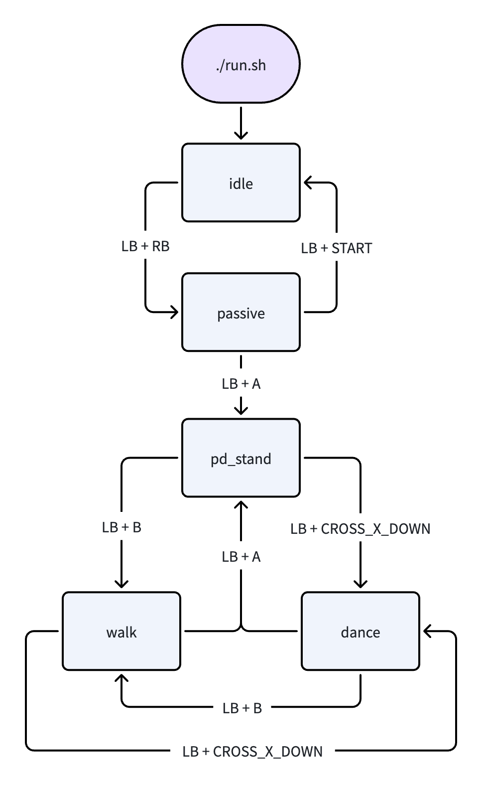
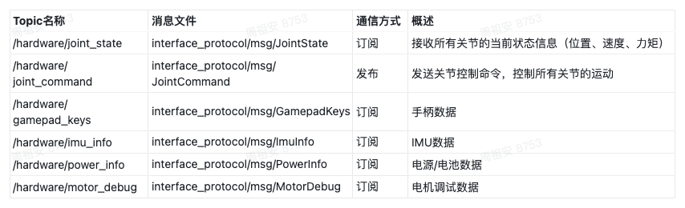

<!-- 来源: https://engineai.com.cn/open/docs/t800/native-sdk/02?product=pm01 -->

# 2. 开发环境与快速开始

#### 1 容器环境

- 安装Docker和Docker Compose

- Docker 提供了一个自动配置与安装的脚本，支持 Debian、RHEL、SUSE 系列及衍生系统的安装。

- 请注意，Docker 官方不建议在生产环境使用此脚本安装 Docker CE。
 | Bash
```
curl -fsSL https://get.docker.com -o get-docker.sh
sudo sh get-docker.sh

# 国内用户可使用镜像源(这里使用清华源)
export DOWNLOAD_URL="https://mirrors.tuna.tsinghua.edu.cn/docker-ce"
curl -fsSL https://get.docker.com -o get-docker.sh
sudo sh get-docker.sh
```

- 设置免 sudo 运行（推荐）

 否则每次都要 `sudo docker`

 | Bash
```
sudo usermod -aG docker $USER
```

 然后重新登录 shell：

 | Bash
```
newgrp docker
```

- 验证安装

- 验证 docker
 | Bash
```
docker --version
```

 示例输出

 | PLAIN
```
Docker version 26.1.1
```

- 验证 docker compose
 | Bash
```
docker compose version
```

 示例输出

 | PLAIN
```
Docker Compose version v2.27.0
```

- 生成容器开发环境，执行完成后会生成快捷入口 `engineai_robotics_env`
 | Bash
```
cd native_sdk
./docker/generate.sh
```


成功页面

该命令会自动创建一个容器，将当前仓库路径映射到容器中，即可以容器中构建-运行程序。

- 启动一个新终端，通过快捷命令engineai_robotics_env即可进入开发环境


#### 2 编译

 | Bash
```
# 进入容器
engineai_robotics_env
./build.sh
```

#### 3 运行

 | Bash
```
# 进入容器
engineai_robotics_env
./run.sh
```


- 指定机型运行：
 | Bash
```
./run.sh pm01_edu
```

- 清理容器环境

如果需要清理掉容器环境可以运行

 | PLAIN
```
#in host
engineai_robotics_env clean
```

#### 4 运动状态切换

##### 4.1 输入方式

当前 Native SDK 支持两种控制输入方式，用于触发机器人状态切换：

 1）实体手柄（Logitech F710）

- 使用 Logitech Wireless Gamepad F710（Xbox 模式）
- 插入 USB 接收器后系统自动识别
- 所有状态切换通过手柄按键触发

 2）虚拟手柄（Virtual Gamepad UI）

- 提供图形化虚拟手柄界面
- 支持通过键盘按键和滑条模拟手柄输入
- 与 F710（XBox 模式）采用一致的控制映射关系，控制逻辑完全兼容


- 启动方式

进入虚拟手柄工具目录并执行启动脚本：

 | PLAIN
```
# 进入容器
engineai_robotics_env
python3 tools/virtual_gamepad/virtual_gamepad.py
```

- 连接与启用

虚拟手柄在使用前需要完成 LCM 连接并手动启用：

- 启动 Virtual Gamepad UI
- 连接 LCM 通信（确保与机器人控制进程正常通信）
- 勾选 **Enable** 或按 **F5** 启动虚拟手柄输入
- 注意事项

- 启用虚拟手柄后：

- 系统会接管输入源
- **实体 Logitech F710 手柄输入将被屏蔽**
- 如需切回实体手柄：

- 关闭虚拟手柄或取消 Enable 状态

 3）控制映射关系（F710 ↔ 虚拟手柄）

 | **功能** | **F710 按键** | **虚拟手柄 UI（鼠标操作）** | **键盘**
 | 左摇杆 | Left Stick | L (Arrow) | ↑ ↓ ← →
 | 右摇杆 | Right Stick | R (Shift+Arrow) | Shift + ↑ ↓ ← →
 | LT | LT | LT 滑条 | 鼠标拖动
 | RT | RT | RT 滑条 | 鼠标拖动
 | LB | LB | LB(q) | Q
 | RB | RB | RB(e) | E
 | A | A | A(j) | J
 | B | B | B(k) | K
 | X | X | X(u) | U
 | Y | Y | Y(i) | I
 | BACK | BACK | BACK(F1) | F1
 | START | START | START(F2) | F2

##### 4.2 状态切换说明

程序启动后，机器人根据手柄指令在不同运动状态之间进行切换。Native SDK 采用有限状态机（FSM）机制管理运动状态：

- 每个状态均定义了明确的进入条件及允许的状态转移路径，只有在满足条件时才允许切换，以保证运动控制的安全性与稳定性
- 状态切换由状态机统一调度，避免非法或不合理的状态跳转
- **状态机配置：** `assets/config/<robot>/task_motion/default.yaml`

状态流转关系如下：



- 系统启动

- 执行 ./run.sh （仿真用）或 ./run_robot.sh（真机用） 后，系统默认进入 idle 状态
- idle 是机器人上电后的初始安全状态，控制器未激活主动运动控制
- 状态切换概览
 | 当前状态 | 允许切换到状态 | 触发按键 | 说明
 | idle | passive | LB + RB | 从未激活状态过渡到阻尼态
 | passive
 | idle | LB + START | 回到未激活状态
 |
 | pd_stand | LB + A | 进入稳定站立控制任务
 | pd_stand
 | walk | LB + B | 建立稳定站立后，进入行走任务
 |
 | dance | LB + CROSS_X_DOWN | 建立稳定站立后，进入跳舞任务
 | walk
 | pd_stand | LB + A | 从行走任务回到稳定站立控制任务
 |
 | dance | LB + CROSS_X_DOWN | 从行走任务切换到跳舞任务
 | dance | pd_stand | LB + A | 从舞蹈任务回到稳定站立控制任务
 |
 | walk | LB + B | 从舞蹈任务切换到行走任务

- 全局安全机制（Emergency Fallback）

- 在任意运行状态下，均可通过 **LB + RB** 组合指令强制切换至 **passive 安全态**
- 该机制等价于软急停（soft emergency stop）：

- 立即终止当前运动控制逻辑
- 将系统切换至受控的安全态（无主动运动输出）
- 该机制在调试及实际运行过程中均为关键保障，用于降低运动失控风险
- 新 Runner 接入建议

- 新增运动控制模块（runner）建议 在 pd_stand 后 才能进入
- 原因：

- pd_stand 提供稳定站立基础
- 确保姿态稳定、接触状态正常
- 避免在被动或未稳定站立时直接进入动态运动带来的安全风险

#### 5 Mujoco 仿真

##### 5.1 编译

 | Bash
```
# 进入容器
engineai_robotics_env
./scripts/build_mujoco.sh
```

##### 5.2 运行

- 确保 assets/config/<robot>/mode.yaml 的 active_mode: sim
 | Bash
```
# 进入容器
engineai_robotics_env
./scripts/run_mujoco.sh
```

指定机型运行：

 | Bash
```
./scripts/run_mujoco.sh pm01_edu
```

运行后即可利用遥控器切换状态。

##### 5.3 仿真性能提升

- 若有NVIDIA独显且已经安装相应的显卡驱动，可以在docker中使用显卡直通提高仿真时的渲染帧率

- 运行以下命令安装NVIDIA的docker工具链
 | Bash
```
**curl -fsSL https://nvidia.github.io/libnvidia-container/gpgkey | sudo gpg --dearmor -o /usr/share/keyrings/nvidia-container-toolkit-keyring.gpg \**
**  && curl -s -L https://nvidia.github.io/libnvidia-container/stable/deb/nvidia-container-toolkit.list | \**
**    sed 's#deb https://#deb [signed-by=/usr/share/keyrings/nvidia-container-toolkit-keyring.gpg] https://#g' | \**
**    sudo tee /etc/apt/sources.list.d/nvidia-container-toolkit.list**

**sudo apt-get update**
**sudo apt-get install -y nvidia-container-toolkit**

**sudo nvidia-ctk runtime configure --runtime=docker**
**sudo systemctl restart docker**
```

- 将`docker/generate.sh`中的`NVIDIA_GPU_AVAILABLE`改成`y`
- 重新执行`docker/generate.sh`即可使用显卡直通


#### 6 真机部署

##### 6.1 配置安装目标并下发

编辑 `install.sh`

 | Bash
```
remote_user="user"
remote_host="192.168.0.163"
remote_dir="~/projects/engineai_robotics"
```

执行安装

 | Bash
```
cd native_sdk

# ./install.sh 机型 mode
./install.sh pm01_edu robot
```

##### 6.2 真机运行

- **安全提示：**

- 确保所有人员与机器人**保持安全距离**
- 若机器人动作异常，随时快速停止（按急停键或切回passive模式）
- 建议先用吊架吊起机器人，在进入PD Stand模式之后放到地上，再切入行走模式
- 运行前准备

- 利用急停遥控器使能机器人的电机系统
- 需要连接机器人热点或用网线连接机器人
 | Bash
```
# ssh 连接 Nezha
ssh user@192.168.0.163

# 暂停自启动的运控程序
sudo systemctl stop robotics.service

# 启动 native_sdk
cd ~/projects/engineai_robotics
sudo ./run_robot.sh pm01_edu
```

后台运行：

 | Bash
```
nohup sudo ./run_robot.sh pm01_edu > nohup.out 2>&1 &
tail -f nohup.out
```

运行后即可根据状态切换说明，利用遥控器按键切换动作

#### 7 数据监测与 ROS2 接入

当前Native SDK支持将机器人运行数据通过 ROS2 接口发布，并结合 PlotJuggler 实现实时可视化。

##### 7.1 ROS2 环境初始化

Native SDK 在构建过程中会自动生成 ROS2 消息接口（msg），用于对外数据通信。

在使用 ROS2 工具（如 PlotJuggler）进行数据订阅前，需要先完成环境加载：

 | Bash
```
# 进入容器
engineai_robotics_env

# 编译（生成 ROS2 msg 与环境）
./build.sh

# 加载 ROS2 环境
source build/ros2_env/install/setup.bash
```

##### 7.2 ROS2 Topic 列表

当前 Native SDK 对外提供以下 ROS2 Topic，用于状态获取与控制交互：



##### 7.3 数据可视化（PlotJuggler）

当前 Native SDK 发布的 ROS2 Topic 可通过 PlotJuggler 进行实时可视化：

典型流程：

- 启动 Native SDK（./run.sh 或 ./run_robot.sh）
- 启动 PlotJuggler
 | Bash
```
# 进入容器
engineai_robotics_env

# 启动 PlotJuggler
./scripts/run_plotjuggler.sh

# 启动 PlotJuggler, 添加多机调试环境
./scripts/run_plotjuggler.sh remote
```

- 选择 ROS2 数据源
- 选择 Native SDK提供的layout

- layout文件在: scripts/plotjuggler/common_data_display.xml


