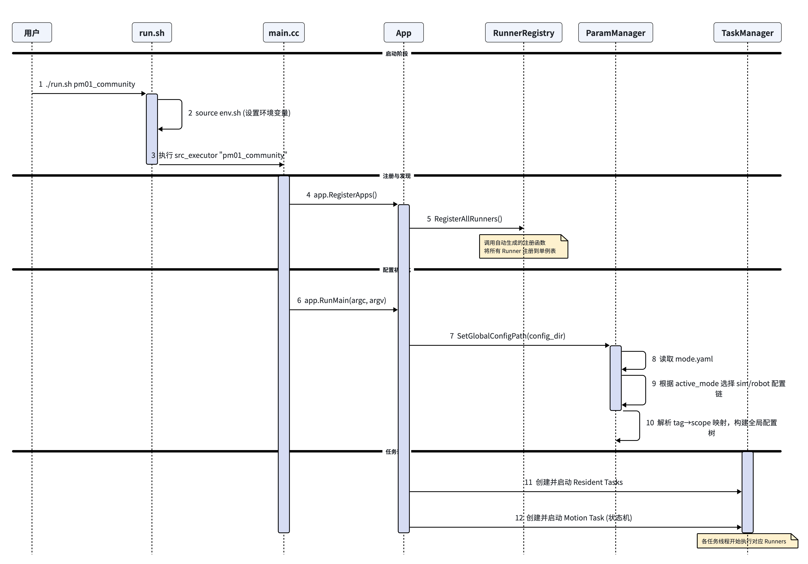
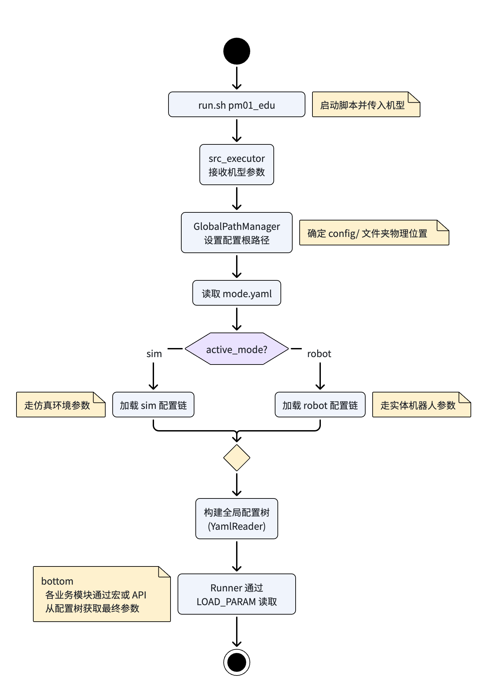
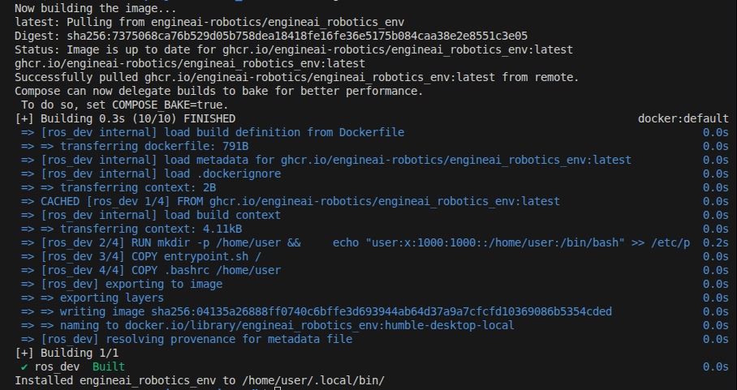
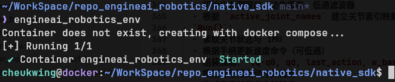

<!-- 来源: https://engineai.com.cn/open/docs/t800/native-sdk/3?product=pm01 -->

# 3.源码解析

## 1.目录结构

 | PLAIN
```
native_sdk/
├── CMakeLists.txt                    # 顶层构建入口（自动识别 core 预编译包）
├── build.sh / run.sh / clear.sh      # 构建、运行、清理脚本
├── install.sh                        # 真机安装脚本
│
├── src/                              # 主要可修改源码
│   ├── executor/main.cc              # 程序入口
│   ├── hardware/                     # gamepad驱动示例
│   ├── protocol/                     # ROS2 msg示例
│   ├── ros2_node/                    # ROS2消息收发示例
│   ├── runner/                       # 自定义/示例 runner
│   │   ├── passive/                  # 电机持续输出低阻抗示例
│   │   ├── pd_stand/                 # 利用PD控制器维持站立示例
│   │   ├── input_command_arbiter/    # 输入源处理示例
│   │   ├── ros2_bridge/              # ROS2数据交换
│   │   ├── rl_dance_example/         # 基于rl方案的舞蹈示例
│   │   └── rl_walking_example/       # 基于rl方案的行走示例
│   └── data/_param/                  # runner参数解析类
│
├── assets/
│   ├── config/<robot>/               # 配置系统入口（mode + task + runner 参数）
│   └── resource/                     # urdf/xml/mesh/策略模型等资源
│
├── core/                             # 预编译核心库（不要直接改）
│   ├── include/                      # 可见头文件（接口）
│   ├── lib/                          # 预编译 so
│   └── registry/auto_register_runners.cc
│
├── cmake/                            # 自动注册等 CMake 辅助脚本
├── simulation/mujoco/                # Mujoco 仿真工程
└── scripts/                          # 辅助脚本（run_robot/run_mujoco 等）
```

## 2 启动流程



## 3 配置加载链路

`assets/config/<robot>/mode.yaml` 是配置系统入口，例如：

 | YAML
```
active_mode: sim
mode:
  sim:
    - tag: motion_task
      scope: task_motion/default
    - tag: pd_stand
      scope: pd_stand/default
  robot:
    - tag: motion_task
      scope: task_motion/default
    - tag: pd_stand
      scope: pd_stand/robot
```

加载逻辑可理解为：

- 先根据 `active_mode` 选择 `sim/robot`
- 建立 `tag -> scope` 映射（如 `pd_stand -> pd_stand/default`）
- `BasicParam(tag)` 根据 `tag` 找到 `scope`
- 参数类中使用 `LOAD_PARAM(xxx)` 从对应 YAML 读取字段



## 4 Task 与 Runner

### 4.1 概念与关系

- Task

- 是调度单元，定义线程、周期、优先级，以及要执行哪些 Runner（`runner[]`）。
- 配置上有两类 Task：

- `task_resident/*.yaml`：常驻任务，启动后并行长期运行。
- `task_motion/*.yaml`：动作任务，同一时刻只激活一个 motion task，通过按键或自动切换迁移。
- Runner

- 是算法执行单元，每个 Runner 负责一段具体逻辑（如估计、控制、驱动）。
- 关系可以理解为：`Task(调度壳)` -> `Runner(业务逻辑)`；Task 按周期驱动 Runner 生命周期接口。

### 4.2 Runner 生命周期与状态流转

- `BasicRunner`（`core/include/basic/basic_runner.h`）定义统一生命周期：

- `Initialize()`：构造后初始化（资源、默认状态）
- `Enter()`：进入当前任务时调用（参数加载、初值准备）
- `Run()`：周期执行主逻辑
- `TryExit()`：退出尝试阶段（可持续多周期执行复位/收敛逻辑）
- `Exit()`：确认退出后执行一次性收尾（变量复位/初始化准备）
- `End()`：生命周期结束时收尾
- `MotionRunner`（`core/include/basic/motion_runner.h`）在上述生命周期上补充了控制相关接口：

- `SetupContext()` / `TeardownContext()`：进入/退出时设置和恢复全局上下文
- `GetMutableOutput().SetCommand(...)`：写入控制输出缓存
- `GetOutput()`：读取当前输出缓存
- 典型调用顺序（`Initialize()`仅在runner构造的时候调用）：

- `resident task` 的 Runner：`Enter -> Run -> TryExit -> Exit -> End`
- `motion task` 的 Runner：`SetupContext -> Enter -> Run -> TryExit -> Exit -> TeardownContext -> End`
- `TryExit()` 与 `Exit()` 的区别：

- `TryExit()`：偏持续性复位，适合“需要时间完成”的退场过程（例如手臂规划回原点）；可能被循环调用，并通过 `kTrying/kCompleted` 告知是否完成。
- `Exit()`：偏一次性处理，通常做变量复位、状态清理和切换前收尾。
- 常见状态与迁移语义：

- `RunnerState`：`kRunning` / `kTryExit` / `kFault`
- `TransitionState`：`kCompleted` / `kTrying` / `kFailed` / `kRestoreRunning`
- 可按下面理解状态机：

- 运行阶段：`kRunning`（持续调用 `Run()`）
- 触发退出：`kTryExit`（进入 `TryExit()`）
- 退出结果：

- `kCompleted`：执行 `Exit()` 并完成切换
- `kTrying`：继续留在`TryExit()`阶段
- `kRestoreRunning`：回到 `kRunning`
- `kFailed`：进入故障/失败处理（通常上层接管）

## 5 RL行走策略部署代码解析

本节以 `RlWalkingExampleRunner` 为例，深度解析基于RL的行走策略在实机框架中的部署逻辑。该 Runner 继承自 `MotionRunner`，严格遵循“数据获取-逻辑计算-缓存输出”的执行范式。整个部署逻辑可拆解为以下三大核心模块：全局参数配置、系统输入源获取、系统输出与缓存仲裁。

### 5.1 全局参数配置与模型初始化

在进入周期控制之前，系统需要完成底层机制开关的设置、配置参数的动态加载以及神经网络模型的实例化。

- **全局控制上下文设置 (SetupContext)**

 采用串联关节训练的RL策略，需要手动将`parallel_by_classic_parser`改为False

 | C++
```
void RlWalkingExampleRunner::SetupContext() {
    data_store_->parallel_by_classic_parser.store(false);
}
```

**脚踝关节控制**



串联驱动脚踝(虚拟)



并联驱动脚踝(真机)

非脚踝关节控制模式，采用MIT控制模式。脚踝关节控制模式，当前存在两种控制模式：

1）串联MIT模式指令转并联MIT模式指令，需要指定`parallel_by_classic_parser=True`（如PD站立模式），用户只需关注串联关节的位置指令、速度指令和力矩前馈指令，会自动转化为电机的位置指令、速度指令和力矩前馈指令，Kp和Kd保持串联关节的值不会进行转换；

2）串联力矩模式指令转并联力矩模式指令，需指定`parallel_by_classic_parser=False`（如RL行走模式），用户只需关注串联关节的位置指令、速度指令和力矩前馈指令，会自动将串联关节的总力矩指令转化为电机的力矩指令，同时下发电机的Kp和Kd会置为0

**注意：**

1）`parallel_by_classic_parser`默认为True，采用串联关节训练的RL策略，需要手动将`parallel_by_classic_parser`改为False；

2）当前脚踝关节仅支持上述两种串联关节指令到并联关节指令转换的控制模式，不支持直接给脚踝电机层的指令（用户自己实现串并解算，可与我们联系）。

- **参数文件读取与动态加载**

 在 Runner 构造时，通过 `ParamManager` 获取默认配置。当状态机触发任务切换进入 `Enter()` 阶段时，系统会校验 `param_tag_`。这一设计允许机器人在不停机的情况下，动态重载不同 tag 的配置文件（如平地行走、上下楼梯等不同步态参数），实现高灵活度的调度。

 | C++
```
if (!param_tag_.empty() && param_tag_ != last_param_tag_) {
  param_ = data::ParamManager::create<data::RlWalkingExampleParam>(param_tag_);
  last_param_tag_ = param_tag_;
}
```

- **推理引擎与模型加载**

 系统采用 `math::MNNModel` 作为轻量化神经网络推理引擎。通过组合全局环境路径与参数文件中指定的相对路径，精准定位并加载 `.mnn` 模型文件。

 | C++
```
mlp_net_ = std::make_unique<math::MNNModel>(
  common::PathJoin(common::GlobalPathManager::GetInstance().GetConfigPath(),
  param_->policy_file)
);
```

### 5.2 系统输入与本体感知

在 `Run()` 周期律动中，Runner 需从全局数据池 (`data_store_`) 中高频提取机器人的物理状态（本体感知）与外界交互指令，为网络构建观测空间。

- **关节状态信息 (Joint State)**

 精确获取各关节的实际位置 `q_real_` 与实际速度 `qd_real_`。底层架构支持通过 `JointInfoType` 枚举类获取更多维度的状态（如前馈扭矩、刚度、阻尼等），满足不同策略的需求。

 | C++
```
// 提取当前关节的真实位置与速度
data_store_->joint_info.GetState(data::JointInfoType::kPosition, q_real_);
data_store_->joint_info.GetState(data::JointInfoType::kVelocity, qd_real_);
```

- **惯性测量单元信息 (IMU State)**

 获取机身四元数与角速度。为了消除安装误差并将数据统一至机器人基座坐标系，代码中执行了标准的坐标系旋转变换，并解算出用于表征机身姿态的重力投影向量。

 | C++
```
// 解析安装偏置与局部四元数
Eigen::Matrix3d R_install = math::RotationMatrixd(math::RollPitchYawd(imu_install_bias_)).matrix();
Eigen::Matrix3d R_local = math::RotationMatrixd(data_store_->imu_info.Get()->quaternion).matrix();
Eigen::Matrix3d R_real = R_local * R_install.transpose();

// 计算基座系下的角速度与重力投影
Eigen::Vector3d w_real = R_real.transpose() * R_local * data_store_->imu_info.Get()->angular_velocity;
Eigen::Vector3d euler_xyz = math::RollPitchYawd(math::RotationMatrixd(R_real)).vector();
Eigen::Vector3d projected_gravity_real = -R_real.transpose() * Eigen::Vector3d::UnitZ();
```

- **用户遥控指令 (Remote Command)**

 解析手柄输入数据，结合不同维度的缩放系数转化为期望的线速度与角速度。为了防止指令突变对模型造成冲击，系统引入了一阶低通滤波器 (lpf_command_) 进行信号平滑。

 | C++
```
void RlWalkingExampleRunner::UpdateRemoteCommand() {
  const auto& gamepad = data_store_->gamepad_info.Get();
  // 根据摇杆推量及缩放参数计算 XYZ 轴向速度期望
  command_.x() = (gamepad->LeftStick_X >= 0) ? gamepad->LeftStick_X * param_->command_scale_pos.x()
                                             : gamepad->LeftStick_X * param_->command_scale_neg.x();
  /* ... y, z 轴处理同理 ... */

  // 应用低通滤波平滑指令输入
  if (param_->enable_remote_command_lpf) {
    command_ = lpf_command_->Update(command_);
  }
}
```

### 5.3 指令缓存与全局仲裁下发

算法推演出的动作不能直接穿透至硬件，必须遵循框架的缓存与统一调度机制，以保证机器人控制指令的安全性和时序严格性。

- **写入局部输出缓存**

 Runner 在完成前向推理后，通过 `GetMutableOutput().SetCommand(...)` 接口，将期望位置 (`q_des_`)、期望速度 (`qd_des_`)、前馈扭矩 (`tau_ff_des_`) 以及底层 PD 增益写入自身的专属缓存区。

 | C++
```
void RlWalkingExampleRunner::SendMotorCommand() {
  // 纯位控模式下，期望速度与前馈扭矩显式置零
  qd_des_ = Eigen::VectorXd::Zero(model_param_->num_total_joints);
  tau_ff_des_ = Eigen::VectorXd::Zero(model_param_->num_total_joints);

  // 仅将指令写入该 Runner 的局部缓存
  GetMutableOutput().SetCommand(q_des_, qd_des_, joint_kp_, joint_kd_, tau_ff_des_);
}
```

- **Task 级整合与同步下发**

 此架构设计的核心在于数据总线解耦。任务管理器 (Task Manager) 会在每个控制周期末尾扮演“仲裁者”角色。它统一收集所有激活态 Runner 的局部缓存，处理可能的指令插值（平滑过渡）、奇异点检查以及扭矩限制。确认安全无误后，再将打包好的完整数据帧严格按照总线通信周期同步下发至各个底层电机。

## 6 控制输入与ROS2 接入

Native SDK 提供统一的输入与对外数据接口机制，用于接收控制指令并与外部系统进行数据交互。整体可分为两类：

### 6.1 控制输入

Native SDK 的控制输入由 `runner/input_command_arbiter` 统一处理。

不同输入设备需要先封装为对应的 Adapter，再注册到 `InputCommandArbiterRunner` 中参与输入源管理。

当前输入源注册位置如下：

 | C++
```
InputCommandArbiterRunner::InputCommandArbiterRunner(
    std::string_view name,
    const std::shared_ptr<data::DataStore>& data_store)
    : BasicRunner(name, data_store) {
  // Register input sources from low to high priority.
  RegisterInputSource("gamepad", std::make_shared<GamepadInputAdapter>("gamepad", data_store));
  RegisterInputSource("virtual_gamepad", std::make_shared<VirtualGamepadInputAdapter>("virtual_gamepad", data_store));
}
```

当前已内置两类输入源：

- `gamepad`：实体手柄输入
- `virtual_gamepad`：虚拟手柄输入

如需扩展新的输入方式（如键盘、网络控制、自定义遥控器等），通常需要完成以下步骤：

- 新增对应的 Input Adapter

- 负责将外部输入转换为框架内部统一的控制输入格式
- 在 `InputCommandArbiterRunner` 中注册该 Adapter

- 通过 `RegisterInputSource(...)` 接入输入源仲裁流程
- 按需设置优先级与切换策略

- 输入源按照注册顺序参与优先级管理（代码注释中当前约定为从低到高优先级）

这样即可在不修改上层控制逻辑的情况下，将新的输入设备接入现有系统。

### 6.2 ROS2 接入

ROS2 对 Native SDK 而言是一个独立的外挂通信模块，通过 `ros2_bridge` 将 ROS2 数据与 Native SDK 进行桥接。

如需扩展 ROS2 功能，通常有以下几类修改方式：

- **新增 ROS2 Node**

- 在 `src/ros2_node` 中新增 node 实现
- **新增 Topic**

- 在已有 node 中增加对应的 publish / subscribe topic
- **新增 Msg**

- 在 `src/protocol` 中增加对应的 msg 定义

完成代码新增后，还需要在 ROS2 Bridge 配置中显式激活。

配置文件位置示例：

 | Bash
```
assets/<robot>/ros2_bridge/default.yaml
```

示例配置如下：

 | YAML
```
activated_node:
  - hardware_interface_node

manager_node:
  subscribe_topics:
    node_control: /motion/node_control

hardware_interface_node:
  enable: true
  period: 0.002
  mapping_periods:
    joint_state: 0.002
    gamepad_keys: 0.02
    motor_debug: 0.01
    power_info: 0.05
  publish_topics:
    imu_info: /hardware/imu_info
    gamepad_keys: /hardware/gamepad_keys
    motor_debug: /hardware/motor_debug
    power_info: /hardware/power_info
    motor_state: /hardware/motor_state
    motor_command: /hardware/motor_command
    joint_state: /hardware/joint_state
    joint_command_feedback: /hardware/joint_command_feedback
  subscribe_topics:
    led_control: /hardware/led_control
```

扩展规则如下：

- **如果增加 node**

- 需要在 `activated_node` 中增加对应 node 名称
- 同时补充该 node 的配置项
- **如果增加 topic**

- 需要在对应 node 配置中的 `publish_topics` 或 `subscribe_topics` 下增加 topic 名称与映射关系
- **如果增加 msg**

- 需要先在 `src/protocol` 中补充消息定义，再在 node 中完成消息收发逻辑与配置映射
