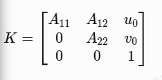

<!-- 来源: https://engineai.com.cn/open/docs/t800/support/03?product=pm01 -->

# 03 · 故障排查：网络 / Topic / 日志 / 软硬件判断

## 1 问题反馈规范

### 1.1 如何提交二次开发问题反馈？

为了提高问题定位效率，请在提交问题时尽可能提供完整的环境信息、复现步骤、现象描述及相关日志。

比如对于较复杂/深入二开场景问题，建议至少提供以下信息：

- **机器人型号**
- **涉及固件/SDK 版本**
- **问题复现步骤**
- **实际现象**
- **预期现象**
- **完整日志或关键日志**
- **相关配置文件**
- **修改过的代码或参数**

注意对于开发者自行开发的内容或实现的业务逻辑，在排除机器人软硬件故障和性能不足的前提下，如果功能不符合预期，一般不属于我们支持的业务范围，需要开发者自行解决

什么样的问题反馈更容易被快速定位？**正例：**

>

PM01，系统版本 XX，ROS2 Humble。 启动 `xxx.launch.py` 后，`/camera/depth/image_raw` 可以看到 Topic，但是 `ros2 topic echo` 没有数据。

执行：

 | Bash
```
ros2 topic info /camera/depth/image_raw -v
```

显示 Publisher QoS 为 BEST_EFFORT，Subscriber 使用 RELIABLE。

修改 Subscriber QoS 后恢复正常。

这种反馈已经包含：

**环境 → 操作 → 现象 → 排查过程 → 日志/命令 → 结果**

什么样的问题反馈不利于定位？**反例：**

>

相机不能用，帮忙看看。

或者：

>

ROS2 没数据。

或者只发送一张机器人现场照片，不提供日志、版本和复现步骤。

**建议：**

>

不建议仅描述“不能用”“没反应”“有延迟”等结论，应尽量说明**什么时候发生、如何复现、具体表现以及已经尝试过哪些操作**。

---

## 2 如何判断软件问题还是硬件问题

### 2.1 如何判断是否为硬件故障？（硬件问题需要联系售后部门获取支持）

可以重点观察：

- 是否只有单个设备异常
- 重启后是否仍然异常
- 软件恢复默认配置/版本后是否仍然异常

例如：

>

某个关节卡顿、限位异常

应用单元内ping不通运控单元板、雷达IP等

上述两类现象应分别处理：

关节卡顿或限位异常：先停止运动，记录关节、故障码、发生条件及版本，联系售后进一步检查；仅凭现象不能判定电机或线缆故障。网络 ping 不通：先检查目标地址、网卡、路由、设备供电与物理连接；也可能是目标禁用 ICMP，不能直接归因于电机。不要自行拆机或带电插拔。

### 2.2 实际测试和官方文档有差异，比如看不到一些话题怎么办？/软件或驱动需要更新怎么办？

先核对机型、固件/SDK/驱动版本与所读文档的适用版本，并检查启动参数、命名空间、节点运行状态和通信配置。话题缺失不一定是版本过旧。确需升级时，向官方支持人员确认兼容版本、升级方法和恢复方案，不要仅为排查而盲目更新。

---

## 3 SSH 与网络连接

### 3.1 无法 SSH 连接机器人怎么办？

建议按照以下顺序检查：

① 在开发电脑检查与目标机器人 IP 的连通性（将命令中的占位 IP 替换为实际地址）

 | Bash
```
ping <robot-ip>
```

② 在机器人本机检查 SSH 服务（需本地控制台或其他已授权访问方式；在开发电脑执行此命令无法检查机器人）

 | Bash
```
systemctl status ssh
```

③ 在开发电脑检查机器人 22 端口（以下 nc 命令适用于已安装 netcat 的 Linux/macOS；Windows PowerShell 可使用 Test-NetConnection -ComputerName 实际机器人IP -Port 22）

 | Bash
```
nc -zv <robot-ip> 22
```

④ 在 Linux 开发电脑检查 IP、网卡与路由；Windows 开发电脑使用 ipconfig 和 route print

 | Bash
```
ip addr
ip route
```

⑤ 在 Linux 开发电脑查看邻居表（Windows 使用 arp -a）；若目标跨路由，邻居表不一定包含目标设备

 | Bash
```
ip neigh
```

如果：

- `ping` 不通 → 优先检查网络/IP/网线/交换机（注意如果开发机同时连接外网，注意避免外网路由器IP为192.168.0.X/24避免混乱和冲突）；
- `ping` 通但 SSH 不通 → 检查 SSH 服务、防火墙、端口；
- SSH 可以连接但频繁断开 → 检查网络稳定性、CPU、系统负载等。

### 3.2 为什么 ROS2 看不到 Topic？

需要检查：

- 物理层/IP层连通性
- 是否source了环境变量
- DDS/RMW 配置
- ROS_DOMAIN_ID
- 网卡
- 防火墙
- UDP 通信
- Multicast
- 网络拓扑

最常见的几类原因，建议优先排查：

- 检查是否能ping通
- source环境变量，如source install/setup.bash等
- 确认两端 ROS_DOMAIN_ID 一致，并按机器人通信配置检查 RMW 与 DDS 的网卡选择和发现设置。本文 ROS2 Humble 跨机通信场景应设置 ROS_LOCALHOST_ONLY=0；值为 1 会限制在本机，不能用于本场景。

---

## 4 ROS2 Topic 常见问题

### 4.1 话题存在但没有数据，如何做基础检查？

建议按照：

 | Bash
```
ros2 topic info /xxx
```

查看 Publisher / Subscriber。

进一步：

 | Bash
```
ros2 topic info /xxx -v
```

重点查看：

- Reliability
- Durability
- History
- Depth

然后：

 | Bash
```
ros2 topic echo /xxx
```

### 4.2 如何确认与处理 QoS 不兼容？

重点检查 **QoS 不匹配**。

例如 Publisher：

 | Text
```
BEST_EFFORT
```

而 Subscriber：

 | Text
```
RELIABLE
```

在 Reliability 策略上，BEST_EFFORT 发布者不能满足 RELIABLE 订阅者的要求；反向组合不应一概判为不兼容。还需检查 Durability 等策略，不能只要求所有 QoS 数值完全相同。

可以使用：

 | Bash
```
ros2 topic info /xxx -v
```

确认发布者的实际 QoS 后再选择订阅设置。例如，发布者采用 BEST_EFFORT 时，可在已配置环境的终端尝试：

 | Bash
```
# 将话题名替换为实际名称
ros2 topic echo /实际话题名 --qos-reliability best_effort
```

若仍无数据，继续确认发布者是否正在产生消息、Durability 是否兼容，以及网络通信。不要为排查而直接改动全部发布节点的 QoS。

对于传感器数据，通常需要重点关注：

 | Text
```
BEST_EFFORT
VOLATILE
KEEP_LAST
```

### 4.3 如何查看 Topic 的发布频率/占用带宽？

 | Bash
```
ros2 topic hz /xxx
```

例如：

 | Bash
```
ros2 topic hz /camera/color/image_raw
```

还可以：

 | Bash
```
ros2 topic bw /xxx
```

查看带宽。

这对于排查**相机数据导致网络带宽过高、CPU 占用过高、消息丢失**非常有用。

---

## 5 相机 / 雷达常见参数资料

### 5.1 如何获取相机和雷达内参/外参？

相机内参通常可以通过话题获取：/camera/cam_head/color/camera_info

TF 可用于查询坐标系之间的变换，但不应把任意 TF 都称为标定外参。odom 到 imu 往往涉及随时间变化的位姿；传感器标定外参需核对固定传感器坐标系对、方向、单位及标定文件。下例先查看实际 frame，再查询选定坐标系：

 | Bash
```
ros2 run tf2_tools view_frames
# 将下面两个 frame 替换为实际、已连通的传感器坐标系
ros2 run tf2_ros tf2_echo 实际源frame 实际目标frame
```

另外还可以查看雷达相机设备ROS driver路径下的标定 YAML 文件，如对于T800雷达相机：

 | Text
```
A11/A22/A12/u0/v0  **相机内参**
Tcl_0              **LiDAR-Camera0 外参**
Tcl_1              **LiDAR-Camera1 外参**
T_cl_cr            **左右相机外参**
```

以下图片为原资料中的矩阵表示示意，不应直接作为所有相机的通用 K 矩阵格式。读取 camera_info 时应区分 K（3×3 内参矩阵）、D（畸变参数）与 P（3×4 投影矩阵）；具体标定 YAML 字段的含义与排列以设备驱动说明为准。



---

## 6 日志与系统排查

### 6.1 如何查看系统日志？

实时查看：

 | Bash
```
journalctl -f
```

查看指定服务：

 | Bash
```
journalctl -u robotics.service
```

查看最近日志：

 | Bash
```
journalctl --since "10 minutes ago"
```

### 6.2 如何查看 Linux 内核日志？

 | Bash
```
dmesg
```

实时查看：

 | Bash
```
dmesg -w
```

查看最近的错误：

 | Bash
```
dmesg | grep -i error
```

USB 问题：

 | Bash
```
dmesg | grep -i usb
```

网络问题：

 | Bash
```
dmesg | grep -i eth
```

CAN：

 | Bash
```
dmesg | grep -i can
```

---

## 7 服务与进程异常

### 7.1 如何判断机器人服务是否正常？

例如：

 | Bash
```
#主运控程序
systemctl status robotics.service
```

查看所有相关服务：

 | Bash
```
systemctl --type=service
```

查看进程：

 | Bash
```
ps aux | grep <process>
```

查看资源：

 | Bash
```
top
```

或者：

 | Bash
```
htop
```

### 7.2 为什么程序启动后 CPU / 内存 / 网络占用很高？

建议同时检查：

 | Bash
```
top
free -h
df -h
```

网络：

 | Bash
```
ip -s link
```

ROS2：

 | Bash
```
ros2 topic hz /xxx
ros2 topic bw /xxx
```

对于相机、点云等高频传感器，重点关注：

>

**分辨率 × FPS × 数据类型 × Topic 数量 × DDS 转发范围**
