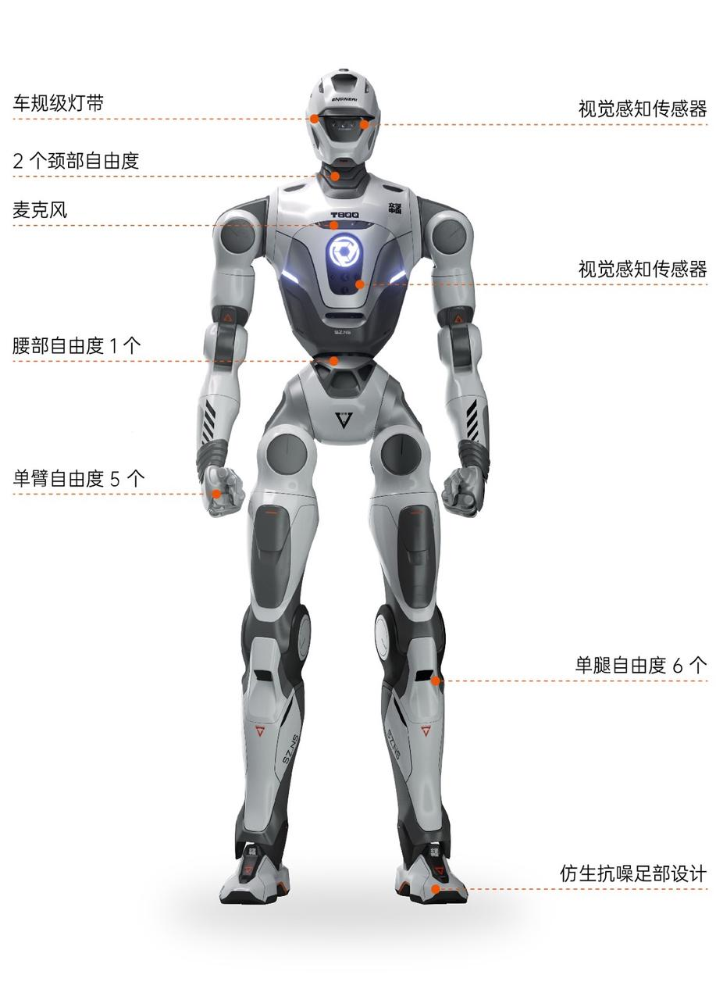

<!-- 来源: https://engineai.com.cn/open/docs/t800/t800-developer/01?product=pm01 -->

# 1. 关于T800（开发版）

众擎 T800 系列是一款面向工业与商业落地的高性能人形机器人，专为实际作业、复杂环境部署及二次开发而设计。作为具备高动态行走与高负载作业能力的人形作业平台，T800 能够稳定完成负重搬运、快速奔跑及精细操作等任务。T800 提供从基础版到 MAX 版的多配置选择，支持灵巧手与完整二次开发环境，为行业用户和科研机构提供强大的硬件与软件基础。

T800 整机分为上半身和下半身，具备多个自由度。单手臂拥有 5 个自由度（基础版），PRO/MAX 版进一步增加腕部自由度；单腿拥有 6 个自由度（髋关节 3 + 膝关节 1 + 踝关节 2）；腰部具备 1 个自由度，头部具备 2 个自由度。根据版本不同，T800 基础版总自由度为 25，PRO 版为 29，MAX 版搭配灵巧手后总自由度最高可达 43。通过最高 450 N·m 关节扭矩的高性能关节电机（行星/谐波），机器人能够实现稳定的动态行走与高负载作业。

目前发售版本的T800整机型号和对应的基本配置如下：

