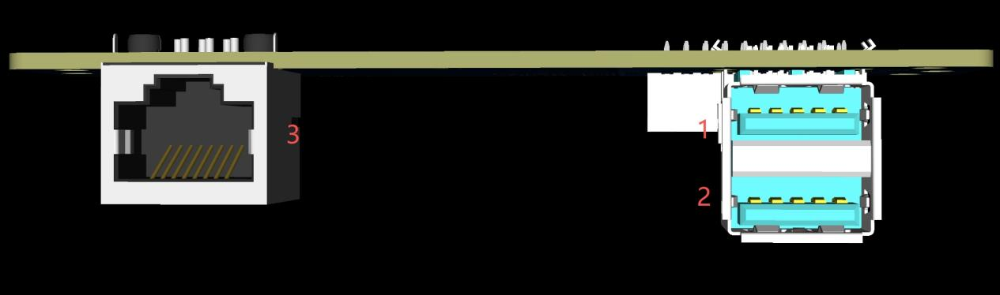

<!-- 来源: https://engineai.com.cn/open/docs/t800/t800-developer/02?product=pm01 -->

# 2. 机器人规格&电气接口

## 1 机器人规格

 | 型号 | T800开发版
 | 产品尺寸 | 173cm(H)
 | 带电重量 | 约84.5kg
 | 小腿+大腿长度 | 91cm
 | 小臂+大臂长度 | 60cm
 | 总自由度 | 25
 | 颈部自由度 | 2
 | 单臂自由度 | 5
 | 腰部自由度 | 1
 | 单腿自由度 | 6
 | 全关节中空走线 | 是
 | 行走速度（前进） | 0~1.5m/s
 | 行走速度（后退） | 0~0.8 m/s
 | 行走速度（侧移） | 0~0.5m/s
 | 行走速度（左右转） | 0~20°/s
 | 跑步速度(硬件支持可达) | <3m/s
 | 最大行进坡度 | 20°（横向坡度+纵向坡度）
 | 最大可跨越高度 | 20cm
 | 腿关节最大峰值扭矩 | 450 N*m
 | 关节编码器 | 绝对式双编码器
 | 关节类型 | 行星
 | 工作温度 | -10℃ ~ 40℃
 | 工作湿度 | 5% ~ 90%（无凝露）
 | 感知传感器 | 自研双目+激光雷达（头部+颈部）
 | 基础算力 | NAZHA
 | 高算力模组 | NVIDIA Jetson AGX Orin 64GB
 | 运行内存 | 64G
 | 硬盘空间 | 256G SSD
 | 二次开发 | 支持
 | 智能电池类型 | 三元锂电池（1.22KWh）
 | 续航时间 | 2h（标配）
 | 充电功率 | 三元锂电池：71.4V*10A
 | 充电时间 | 三元锂电池 2.5h
 | 灯光配置 | 头灯+胸灯+膝盖灯
 | 手持式遥控器 | 支持
 | 灵巧手 | 不支持

## 2 电气接口

 | **序号** | **接口类型** | **接口简称** | **接口说明**
 | 1 | USB A | USB A 3.0 (内部连接AGX ORIN) | 连接 ORIN 高算力模组 5V/1A电源输出
 | 2 | USB A | USB A 3.0 (内部连接NeZha N97) | 连接NEZHA 基础算力模组 5V/1A电源输出
 | 3 | 以太网 | RJ45 | 千兆以太网接口

**补充说明：**

- 外部供电接口：不支持
- 机身充电接口：不支持（电池需单独充电）
