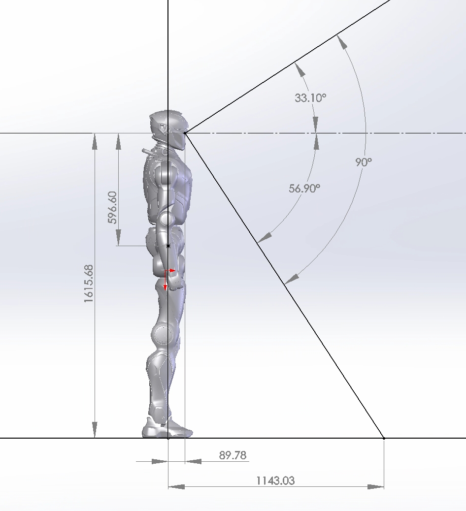

<!-- 来源: https://engineai.com.cn/open/docs/t800/t800-developer/04?product=pm01 -->

# 4. T800 传感器配置

## 1 配置清单

 | **传感器分类** | **传感器类型** | **位置/数量** | **数量**
 | 基础 | 视觉感知RGB | 头部 | 1（双目）
 |
 | 激光雷达 | 头部 | 1
 |
 | IMU | 躯干中心 | 1
 |
 | 扭矩传感器 |
 | 主要关节
 | 安全交互 | 麦克风阵列 | 头部 | 环麦 4
 |
 | 高保真扬声器 | 躯干 | 2个

## 2 T800传感器安装

### 2.1 深度相机的安装与参数

头部搭载Odin2相机，为机器人提供了卓越的视觉感知能力，能够更准确地感知和理解周围环境，实现精确的空间感知和障碍物检测，使机器人能够更智能、灵活地与环境进行交互和应对各种场景。

### 2.2 IMU模组参数

#### 2.2.1 姿态角参数

 | **参数** | **子项** | **典型值** | **备注**
 | **横滚角** | 精度 | 0.05° | 1σ RMS，25℃测量，静态/无长时间加速下
 |
 | 量程 | ±180° |

 | **俯仰角** | 精度 | 0.05° | 1σ RMS，25℃测量，静态/无长时间加速下
 |
 | 量程 | ±90° |

 | **无参考航向角** | 精度 | 0.2° | 1σ RMS，25℃测量，上电时航向角默认为0°
 |
 | 量程 | ±180° |

 | **磁参考航向角** | 精度 | 1° | 1σ RMS，需在稳定磁场中且磁传感器经过现场校准
 |
 | 量程 | ±180° |

 | **角度分辨率** |
 | 0.001° | 传感器在量程内可检测的最小变化值

#### 2.2.2 陀螺仪参数

 | **参数** | **典型值** | **备注**
 | **量程** | ±450°/s |

 | **非线性度** | ±0.05%FS |

 | **噪声密度** | 0.015°/s/√Hz |

 | **零偏不稳定性** | 5°/h | Allan variance, 1σ
 | **带宽(-3dB)** | 50Hz |

 | **零点偏移** | ±0.5°/s | 1σ RMS
 | **零点温漂** | ±1°/s | 1σ RMS, -40~85℃

#### 2.2.3 加速度计参数

 | **参数** | **典型值**
 | **量程** | ±16g
 | **非线性度** | ±0.1%FS
 | **噪声密度** | 100ug/√Hz
 | **零偏不稳定性** | 0.035mg
 | **带宽(-3dB)** | 50Hz
 | **零点偏移** | ±20mg
 | **零点温漂** | ±10mg

#### 2.2.4 磁传感器参数

 | **参数** | **典型值** | **备注**
 | **量程** | ±8Gauss |

 | **非线性度** | ±0.1%FS | FS = ±8G
 | **噪声** | 0.4mGauss | RMS

#### 2.2.5 物理与电气指标

 | **参数** | **典型值** | **备注**
 | **输入电压** | 5VDC | 噪声≤30mV peak-peak
 | **功耗** | 190mW | @5V
 | **通信接口** | UART / USB | UART对应货号YIS320-E11，USB对应YIS320-E30
 | **输出协议** | Yesense YIS protocol | Yesense私有协议
 | **输出频率** | 200Hz | 最高400Hz
 | **尺寸** | 22.4×22.4×9.4mm |

 | **重量** | 7.7g | ±1g
 | **外壳材质** | 铝合金 |

#### 2.2.6 环境适应性指标

 | **参数** | **典型值** | **备注**
 | **工作温度** | -40~85℃ |

 | **存储温度** | -45~85℃ | 相对湿度≤65%
 | **抗冲击性** | 2000g |
