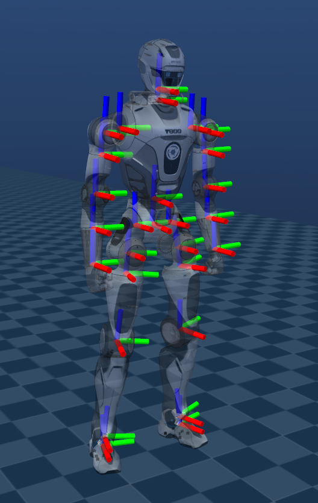

<!-- 来源: https://engineai.com.cn/open/docs/t800/t800-developer/05?product=pm01 -->

# 5. 关节电机&整机坐标及构型

## 1 关节电机

T800关节电机系统采用了众擎自研的Q系列高性能伺服电机（包含Q300H、Q200H、Q50H、Q25H等型号），覆盖了从大扭矩主关节到轻量化末端关节的全方位需求。其中Q300H‑L主关节电机关节端峰值扭矩可达415 N·m；Q300H关节端峰值扭矩370 N·m；Q200H关节端峰值扭矩222 N·m；Q50H轻量关节电机峰值扭矩160 N·m；Q25H微型关节电机峰值扭矩52 N·m。所有Q系列电机均采用中空轴线设计，在保证高强度的同时实现结构轻量化和紧凑化，便于内部走线。

电机集成双编码器系统，配合高精度位置编码器和力矩/电流传感器，能够提供精准的位置、速度及力反馈，满足高动态运动控制需求。得益于低惯量转子设计（例如Q300H等效关节端转子惯量低至0.14 kg·m²，Q25H低至0.0067 kg·m²），关节具备极快的响应速度和优异的动态性能。优化的散热结构支持电机长时间高负载运行，保证机器人持续稳定工作。此外，L05直线关节和F17手指关节，实现了全臂端的柔顺与精准操控。

T800 开发版整机关节配置简图如下：

关节电机相关规格参数如下：

 | 电机型号 | Q25H | Q50H | Q200H | Q300H | Q300H-L
 | 关节编码器 | 双编码 | 双编码 | 双编码 | 双编码 | 双编码
 | 关节类型 | 全行星 | 全行星 | 全行星 | 全行星 | 全行星
 | 最大力矩(Nm) | 50 | 160 | 222 | 370 | 415
 | 峰值扭矩密度（Nm/kg） | 100 | 168 | 134 | 176 | 160
 | 最高转速(rpm) | 8400 | 8000 | 3200 | 6000 | 5800
 | 减速比 | 25 | 25 | 14.45 | 24 | 24
 | 质量(kg) | 0.5 | 0.95 | 1.65 | 2.1 | 2.6
 | 直径(mm) | 62 | 76 | 97 | 110 | 110
 | 高度(mm) | 60 | 62 | 65 | 65 | 80
 | 额定电压(V) | 48 | 63 | 63 | 63 | 63
 | 力控精度 | 5% | 5% | 5% | 5% | 5%

## 2 整机坐标系及构型

### 2.1 坐标系

当各个关节处于默认姿态时，各坐标系如下图。红色为 x 轴，绿色为 y 轴，蓝色为 z 轴。

### 2.2 关节序号与关节运动空间

 | **序号** | **连杆** | **连杆、meshes命名** | **关节命名** | **关节运动空间**
**(rad)**
 | 1 | 左髋俯仰 | LINK_HIP_PITCH_L | J00_HIP_PITCH_L | -2.88 ~ 2.181
 | 2 | 左髋横滚 | LINK_HIP_ROLL_L | J01_HIP_ROLL_L | -0.2618 ~ 1.7444
 | 3 | 左髋偏航 | LINK_HIP_YAW_L | J02_HIP_YAW_L | -1.4137 ~ 3.8921
 | 4 | 左膝俯仰 | LINK_KNEE_PITCH_L | J03_KNEE_PITCH_L | -0.261667 ~ 2.355
 | 5 | 左踝俯仰 | LINK_ANKLE_PITCH_L | J04_ANKLE_PITCH_L | -0.68068 ~ 0.68068
 | 6 | 左踝横滚 | LINK_ANKLE_ROLL_L | J05_ANKLE_ROLL_L | -0.3491 ~ 0.1745
 | 7 | 右髋俯仰 | LINK_HIP_PITCH_R | J06_HIP_PITCH_R | -2.879 ~ 2.181
 | 8 | 右髋横滚 | LINK_HIP_ROLL_R | J07_HIP_ROLL_R | -1.7444 ~ 0.2618
 | 9 | 右髋偏航 | LINK_HIP_YAW_R | J08_HIP_YAW_R | -3.8921 ~ 1.4137
 | 10 | 右膝俯仰 | LINK_KNEE_PITCH_R | J09_KNEE_PITCH_R | -0.261667 ~ 2.355
 | 11 | 右踝俯仰 | LINK_ANKLE_PITCH_R | J10_ANKLE_PITCH_R | -0.68068 ~ 0.68068
 | 12 | 右踝横滚 | LINK_ANKLE_ROLL_R | J11_ANKLE_ROLL_R | -0.1745 ~ 0.3491
 | 13 | 腰偏航 | LINK_TORSO_YAW | J12_TORSO_YAW | -2.81 ~ 2.81
 | 14 | 左肩俯仰 | LINK_SHOULDER_PITCH_L | J13_SHOULDER_PITCH_L | -3.229 ~ 2.443
 | 15 | 左肩横滚 | LINK_SHOULDER_ROLL_L | J14_SHOULDER_ROLL_L | -0.436 ~ 2.487
 | 16 | 左肩偏航 | LINK_SHOULDER_YAW_L | J15_SHOULDER_YAW_L | -2.618 ~ 2.618
 | 17 | 左肘俯仰 | LINK_ELBOW_PITCH_L | J16_ELBOW_PITCH_L | -2.295 ~ 0.288
 | 18 | 左肘偏航 | LINK_ELBOW_YAW_L | J17_ELBOW_YAW_L | -2.618 ~ 2.618
 | 19 | 右肩俯仰 | LINK_SHOULDER_PITCH_R | J18_SHOULDER_PITCH_R | -3.229 ~ 2.443
 | 20 | 右肩横滚 | LINK_SHOULDER_ROLL_R | J19_SHOULDER_ROLL_R | -2.487 ~ 0.436
 | 21 | 右肩偏航 | LINK_SHOULDER_YAW_R | J20_SHOULDER_YAW_R | -2.618 ~ 2.618
 | 22 | 右肘俯仰 | LINK_ELBOW_PITCH_R | J21_ELBOW_PITCH_R | -2.295 ~ 0.288
 | 23 | 右肘偏航 | LINK_ELBOW_YAW_R | J22_ELBOW_YAW_R | -2.618 ~ 2.618
 | 24 | 头俯仰 | LINK_HEAD_PITCH | J23_HEAD_PITCH | -0.523 ~ 0.523
 | 25 | 头偏航 | LINK_HEAD_YAW | J24_HEAD_YAW | -1.222 ~ 1.222

- 关节运动空间参数见 URDF
