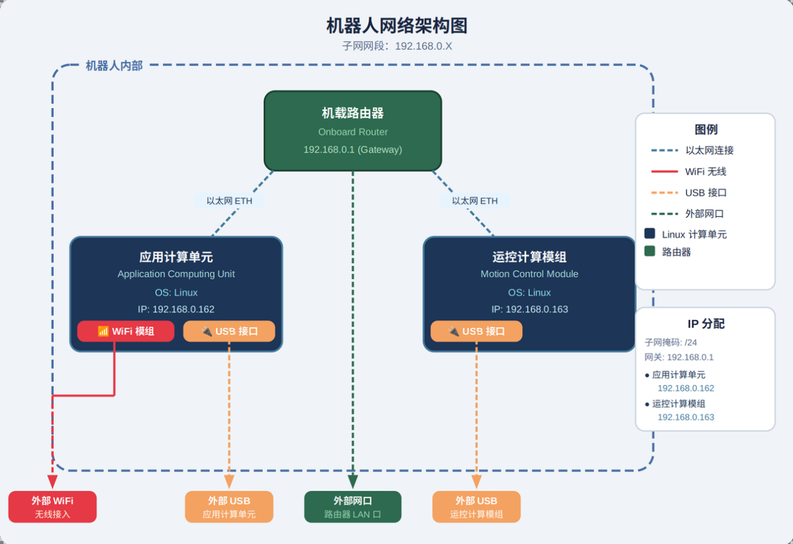

<!-- 来源: https://engineai.com.cn/open/docs/t800/t800-pro/03?product=pm01 -->

# 3. 机载计算机&网络架构图

## 1 机载计算机

T800 pro标配【基础算力模组（Robot PC）**】+**【高算力模组（AI PC）】

 | 参数 | Nezha | NVIDIA Jetson AGX Orin 64GB（开发版/PRO版）
 | 内核数 | 4 | 12
 | 内存 | 8GB | 64GB
 | 存储 | eMMC 64GB | 256G SSD
 | IP 地址 | 192.168.0.163 | 192.168.0.162
 | 运行操作系统 | Ubuntu | Ubuntu

- 【基础算力模组】及【高算力单元】初始用户名和密码、IP地址如下图列表所示。
 | **Device** | **IP** | **SSH Username** | **SSH Password**
 | Nezha | 192.168.0.163 | user | 1
 | Jetson Orin | 192.168.0.162 | ubuntu | ubuntu

## 2 网络架构图

